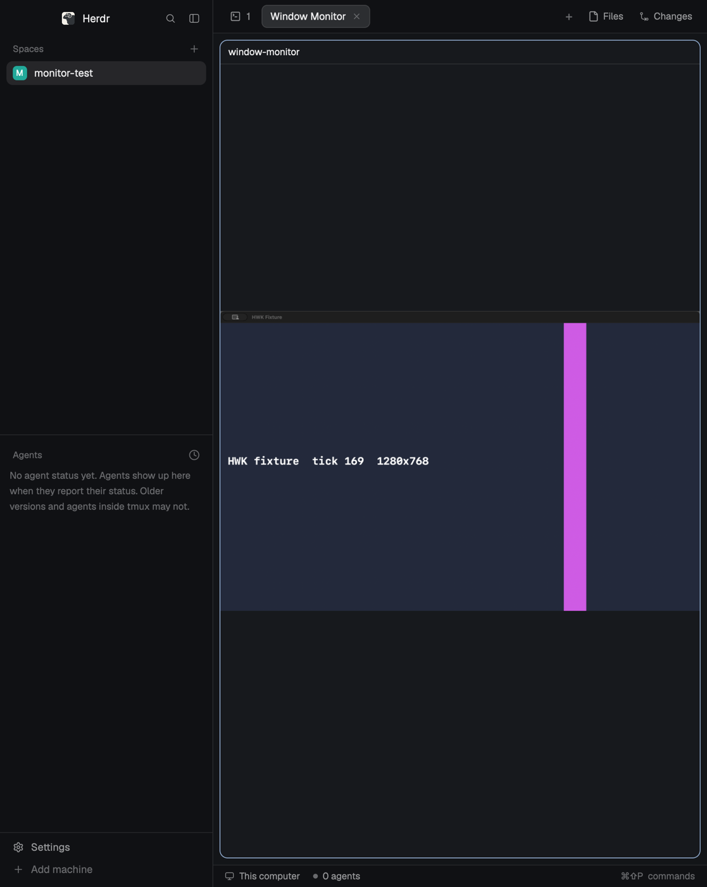

# Window Monitor for Herdr

macOSのほかのウィンドウを、HerdrのPaneの中で見るためのModです。表示するだけで、音声・カーソルは取り込まず、クリックやキー入力も相手のウィンドウへ送りません。



[English](README.md)

## 導入

必要なもの：macOS 14以降、Herdr 0.1.13（動作を確認したバージョン）、取得用helperをビルドするためのXcodeコマンドラインツール（`xcode-select --install`）。

1. `mods/window-monitor/` を `~/.config/herdr-app/mods/` にコピーします。エージェントにこのリポジトリの追加を頼んでもかまいません（Herdrの共有Modの手順に沿っています）。
2. 新しいタブで開きます。

   ```sh
   herdr-app do tab.new '{"name":"Window Monitor","mod":"window-monitor"}'
   ```

   今のPaneの横に開く場合は `herdr-app do pane.split '{"direction":"right","mod":"window-monitor"}'` です。

   Herdr標準のコマンドパレットにはModが出ません。パレットのModを自分用に複製して使っている場合は、その `NAMED` の一覧に `["tab.new", { name: "Window Monitor", mod: "window-monitor" }, "Tab", "Window Monitor", "window monitor watch ウィンドウ 監視"]` のような1行を足すと、パレットから開けます。
3. 初回は「helperをビルド」と表示されます。押すと `mods/window-monitor/helper/` のSwiftソースをこのMacでビルドし、`mods/window-monitor/.bin/` に置きます（10秒ほど）。何もダウンロードしません。`mods/window-monitor/helper/build.sh` を自分で実行してもかまいません。
4. 画面収録がまだ許可されていなければ、Paneに案内が出ます。「許可を求める」を押し、システム設定 › プライバシーとセキュリティ › 画面とシステムオーディオ録音 で Herdr または herdr-core をオンにしてから、「もう一度確認」を押します。

## 使い方

- 準備ができると、ウィンドウ一覧のダイアログが開きます。各ウィンドウは今の様子のサムネイル付きのカードで並び、ダイアログを開いている間は2秒ごとに更新します。選んで「開始」を押すか、カードをダブルクリックします。前回のウィンドウがあれば選択済みにしますが、「開始」を押す（またはダブルクリックする）まで取り込みは始まりません。
- 監視中のPaneは映像だけです。マウスを乗せると上部に細いバーが出て、「停止」「小窓で表示」「別のウィンドウ」「設定」のアイコンボタンが並びます。アイコンにマウスを乗せると名前が出ます。
- 「小窓で表示」を押すと、映像をHerdrの中のどのタブの上にも浮かぶ小窓（長辺480 px）に移します。別のタブで作業しながら見続けられます。小窓はドラッグで好きな位置に動かせて、Paneごとに最後に置いた位置で開きます。Paneと同じように拡大でき、拡大中のドラッグは小窓の移動ではなく映像の移動になります。マウスを乗せると「Paneに戻す」が出ます。小窓で表示している間、Paneにはどのウィンドウを小窓で表示しているかと、「Paneに戻す」「別のウィンドウ」「設定」「停止」のボタンが出ます。小窓はHerdrのウィンドウの中だけに出ます（ほかのアプリの上に浮かぶmacOSのピクチャ・イン・ピクチャではありません）。Herdrのレイアウトを切り替えると閉じます。
- トラックパッドを2本指でスクロール（またはマウスホイール）すると、キーを押さずにポインタの位置を中心に最大800 %まで拡大縮小します。拡大中は映像をドラッグすると動かせます。映像をダブルクリックするか、右下の「<倍率> %・全体表示」ボタンで元に戻ります。映像は長辺1280 pxまでで取り込むため、大きく拡大するとぼやけます。トラックパッドのピンチは使えません。Herdrがピンチ操作をModに渡さないためです。
- 一時停止中、取得終了、ウィンドウが閉じられた、など映像が最新でないときは、映像の上に知らせを出し続けます。止まった映像を監視中と見間違えないためです。
- Paneが別のタブにあるときやHerdrを最小化したときは取り込みを止め、表示を戻すと再開します。小窓を開いている間は、どのタブでも取り込みます。Paneを閉じると止めて、小窓を閉じ、画像も削除します。
- 1つのPaneで見られるウィンドウは1つです。たくさん見たいときはPaneを増やします。ほかのPaneで監視中のウィンドウは一覧にそう表示され、重ねて選べません。

### 設定：フレームレート

1秒あたりに表示する新しい画像の上限です。**1**、**2**（既定）、**5**、**10**、**20 fps** から選べます。変化のないウィンドウからは新しい画像を送りません。レートを上げるほど滑らかになりますが、CPUの使用量とPNGの書き込み量が増えます（「制限」を参照）。下の待ち時間を250 msにすると、この設定にかかわらず毎秒約4枚が上限です。次に取り込みを開始したときから反映します。

### 設定：新しい画像を表示する前の待ち時間

Herdrには「新しい画像の読み込みが終わった」とModに知らせる仕組みがないため、画像を切り替えるときに一瞬空白になったり、1つ前の画像に戻ったりすることがあります。

| 設定 | 遅れ | 見え方 |
|---|---|---|
| 0 ms・速さ優先（既定） | 約0.2秒 | ときどき一瞬の空白や、1つ前の画像への逆戻りがある |
| 250 ms・ちらつき軽減 | さらに約0.3秒 | 短い試験では起きなかったが、保証はしない |

設定は次に取り込みを開始したときから反映します。表示言語はmacOSの設定に合わせます（日本語か英語）。

### 設定：負荷

設定を開いている間は、直近1分の負荷を小さなカードに1秒ごとのグラフで表示します。**取り込み**はこのPaneのhelperプロセスのCPU、**Herdr全体**は画像の表示を含むHerdrアプリ全体のCPU、**画像の保存**は1秒あたりのPNGの書き込み量です。CPUは1コア = 100 %です。helperのいまのメモリは、見出しの右に数字で出します。行にポインタを乗せると、何を測っているかが出ます。取り込み中でなければ、取り込みの値は「—」になります。

## Macの上で行うこと

Herdrは、Modを追加する前にこの内容を利用者へ伝えるよう、エージェントに求めています。

- **実行するプログラム：** 同梱ソースからビルドした自分のhelper（`.bin/window-monitor-helper`）を `hc run` でバックグラウンドの端末として起動します。ダイアログのウィンドウ一覧とサムネイルは、その複製の `.bin/window-monitor-lister` で取得します。ほかに `/bin/sh`、`mkdir`、`rm`、`test`、`defaults read -g AppleLanguages`、`open`（システム設定を開く）、「helperをビルド」を押したときの `helper/build.sh` を使います。設定を開いている間は、負荷のカードのために `pgrep`、`head`、`ps`、`sed` を1秒ごとに実行します。
- **自分のフォルダーの外の読み書き：** 開いているPaneごとに `~/.config/herdr-app/mods/window-monitor-feed-<id>/` を使います。中身は制御ファイル、helperの統計、最新3〜4枚のPNG（長辺1280 px以下、設定したフレームレートで書き込み。既定は毎秒2枚、最大で毎秒20枚）と、ウィンドウ一覧のダイアログを開いている間は最新2回分のサムネイル（長辺480 px以下）です。停止すると画像を、ダイアログを閉じるとサムネイルを、Paneを閉じるとフォルダーを削除します。動いているPaneが1分以上触れていないフォルダー（クラッシュ時や、Modを更新したときに置き去りになったものなど）は、Paneを開いたときに削除します。自分のフォルダーの中には、一覧の取得を同時に走らせないための `.bin/window-monitor-lister.lock` を作ります。
- **ネットワーク：** 使いません。
- **取り込む範囲：** ウィンドウ一覧のダイアログを開いている間は、一覧に出るすべてのウィンドウの静止画を2秒ごとに撮ります。それ以外は、選んだウィンドウだけを、そのPaneが表示されている間だけ取り込みます。

## 制限

- Apple Silicon、macOS 26.6、Herdr 0.1.13で、試験用ウィンドウを使って確認しました。何時間も続けて使う試験はしていません。
- Herdrに画面収録を一度も許可していないMacでの、最初の許可の流れは試していません。
- 小窓は、開く、タブを切り替える、Paneに戻す、停止する、Paneを閉じる、をModのコマンドで試しました。小窓の中のマウス操作（ドラッグ、拡大、小窓の「Paneに戻す」ボタン）は試していません。
- 新しい画像は毎回PNGファイルとして書き込みます（監視中のウィンドウが動いている間、2 fpsで毎秒約0.25 MB、フレームレートに応じて増えます）。ウィンドウ一覧のダイアログを開いている間は、更新のたびにサムネイルを約1〜2 MB書き込みます（ウィンドウの数によります）。
- 20 fpsで、常に変化する1280×800のウィンドウを取り込んだとき、helperはCPU 1コアの約20 %を使い、PNGを毎秒6〜7 MB書き込みました。変化しているウィンドウをPaneに表示する試験は2 fpsでしかしていません（5、10、20 fpsは未確認）。
- あるPaneで取り込みを開始・停止すると、別のPaneの取り込みが数秒途切れることがあります。helperが自動で取り込みを作り直します。

## ライセンス

MIT。[LICENSE](LICENSE) を参照してください。
