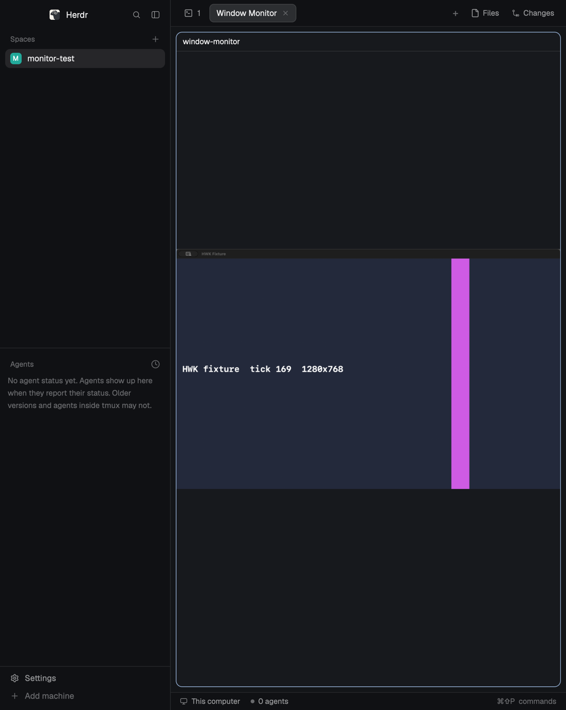

# Window Monitor for Herdr

Watch another macOS window inside a Herdr pane. Display only: no audio, no cursor, no clicks or keys go to the watched window.



[日本語](README.ja.md)

## Install

Requirements: macOS 14 or later, Herdr 0.1.13 (the version this was tested with), and the Xcode Command Line Tools (`xcode-select --install`) to build the capture helper.

1. Copy `mods/window-monitor/` into `~/.config/herdr-app/mods/`, or ask your agent to add this repository (it follows Herdr's own instructions for shared mods).
2. Open the monitor in a new tab:

   ```sh
   herdr-app do tab.new '{"name":"Window Monitor","mod":"window-monitor"}'
   ```

   or next to the current pane: `herdr-app do pane.split '{"direction":"right","mod":"window-monitor"}'`.

   Herdr's command palette doesn't list mods. If you use your own copy of the palette mod, add an entry to its `NAMED` list, for example `["tab.new", { name: "Window Monitor", mod: "window-monitor" }, "Tab", "Window Monitor", "window monitor watch"]`.
3. The first time, the pane asks you to **Build helper**. It compiles the Swift sources in `mods/window-monitor/helper/` on your Mac (about 10 seconds) into `mods/window-monitor/.bin/`. Nothing is downloaded. You can also run `mods/window-monitor/helper/build.sh` yourself.
4. If macOS hasn't allowed screen recording yet, the pane says so. Press **Request access**, turn on Herdr or herdr-core in System Settings › Privacy & Security › Screen & System Audio Recording, then press **Check again**.

## Use

- When the pane is ready, a dialog shows your windows as cards with a current thumbnail of each, refreshed every 2 seconds while the dialog is open. Pick one and press **Start**, or double-click a card. The window you watched last time is preselected; capture never starts without pressing Start (or double-clicking).
- While watching, the pane shows only the picture. Move the pointer over it for the bar: **Stop**, **Other window**, **Settings**.
- Zoom with a two-finger scroll on the trackpad (or the mouse wheel), no key needed, up to 800 %, around the pointer. While zoomed, drag the picture to move it. Double-click the picture, or press the **<zoom> % · Fit** button at bottom right, to fit it again. The picture is captured at most 1280 px on its long side, so high zoom gets blurry. Trackpad pinch isn't available: Herdr doesn't pass pinch gestures to mods.
- A notice stays on the picture whenever it isn't live (paused, ended, the window was closed), so a frozen image can't pass for a live one.
- Capture pauses while the pane is in another tab or Herdr is minimized, and resumes when it shows again. Closing the pane stops it and deletes its images.
- One window per pane. Open more panes to watch more windows; a window already watched in another pane is shown as such and can't be picked twice.

### Settings: frame rate

The most new images per second: **1**, **2** (default), **5**, **10** or **20 fps**. A window that doesn't change sends no new images. A higher rate is smoother but uses more CPU and writes more PNG data (see Limits). With the 250 ms wait below, about 4 images per second at most, whatever the setting. Applies the next time a capture starts.

### Settings: wait before showing a new image

Herdr has no way to tell a mod that a new image has finished loading, so switching images can briefly show a blank or the previous image.

| Setting | Delay | What you may see |
|---|---|---|
| 0 ms · fastest (default) | about 0.2 s | now and then an instant blank or a jump back to the previous image |
| 250 ms · less flicker | about 0.3 s more | none in short tests, but not guaranteed |

The setting applies the next time a capture starts. The language follows macOS (Japanese or English).

## What it does on your Mac

Herdr asks agents to tell you this before adding a mod.

- **Runs programs:** its own helper (`.bin/window-monitor-helper`, built from the included source), started as a background terminal with `hc run`; a copy of it, `.bin/window-monitor-lister`, that lists windows and takes their thumbnails for the dialog; `/bin/sh`, `mkdir`, `rm`, `test`, `defaults read -g AppleLanguages`, `open` (System Settings), and `helper/build.sh` when you press Build helper.
- **Reads and writes outside its folder:** `~/.config/herdr-app/mods/window-monitor-feed-<id>/` for each open pane: a control file, the helper's stats, the newest three or four PNG frames (1280 px at most, at the frame rate set in Settings: 2 per second by default, 20 at most) and, while the window dialog is open, the newest two sets of thumbnails (480 px at most). Stopping deletes the frames; closing the dialog deletes its thumbnails; closing the pane deletes the folder. Folders no live pane has touched for a minute (left by a crash, or by a pane dropped when the mod was updated) are deleted when a pane opens. Inside its folder: `.bin/window-monitor-lister.lock`, so two listings never run at once.
- **Network:** none.
- **Captures:** while the window dialog is open, a still image of every window it lists, every 2 seconds; otherwise only the window you picked, and only while its pane is visible.

## Limits

- Tested on Apple Silicon, macOS 26.6 and Herdr 0.1.13, with a test window. Long sessions (hours) are not tested.
- The very first permission prompt flow on a Mac that never allowed screen recording for Herdr is not tested.
- Each new image is written as a PNG file (about 0.25 MB/s at 2 fps while the watched window changes, rising with the frame rate). While the window dialog is open, each refresh writes about 1–2 MB of thumbnails (depends on the number of windows).
- At 20 fps, a constantly changing 1280×800 window measured about 20 % of one CPU core and 6–7 MB/s of PNG writes in the helper. 5, 10 and 20 fps are not tested for display in a pane with a changing window (only 2 fps is).
- Starting or stopping one capture can interrupt another pane's capture for a few seconds; the helper rebuilds its stream by itself.

## License

MIT. See [LICENSE](LICENSE).
