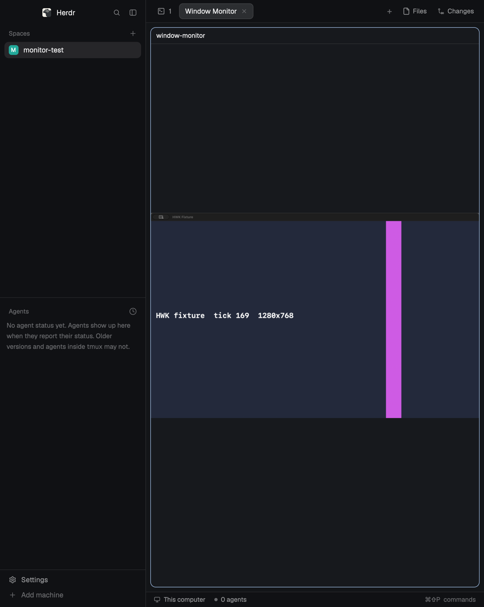

# Window Monitor

A pane that shows another macOS window live, as a picture: you pick a window from a dialog, press Start, and the pane fills with that window's image, refreshed up to 1, 2 (default), 5, 10 or 20 times a second. Display only. Hover the picture for Stop, Other window and Settings.

## What you see

The mod is a pane mod (`mod.json` `{"place": "none"}`), opened with `tab.new {mod: "window-monitor"}` or `pane.split {direction, mod: "window-monitor"}`. Everything uses `theme()` colors and 13 px text.

- **Setup (until ready):** centered in the pane, a `surface` card (8 px radius, 16 px padding, at most 520 px wide) with a semibold title, a `muted` explanation and buttons. Two cards exist: "The capture helper is not built yet" with **Build helper** (label turns into "Building the helper…" while it runs), and "Screen recording permission is needed" with **Request access**, **Open System Settings**, **Check again**. Errors show above the card in `blocked`; any other failure shows only a **Check again** button.
- **Picker dialog** (`openOverlay` kind `dialog`, 760×560): `popover` background, 16 px padding, 10 px gaps. Header: "Choose a window to watch" (15 px, semibold). Then an error line (`blocked`), "Looking for windows…" until the first listing, or "The window from last time is selected." (`muted`). Then a scrolling grid of cards, as many columns of at least 200 px as fit, 10 px gaps. A card: 6 px padding, 6 px gaps, 8 px radius, 2 px border, `surface` (selected: `selected` with an `accent` border; hover `hover`); a thumbnail box 0.625 as high as wide on `background` (4 px radius) holding the window's latest thumbnail, aspect kept and centered, or "No preview" (`muted`); the app name (semibold, truncated); `<title or Untitled> · <w>×<h>` (`muted`, truncated). A window another pane is watching is at 50 % opacity, not clickable, with " · watched in another pane". Click selects, double-click selects and starts. Bottom right: **Cancel** and **Start** (`solid`/`solid_foreground`, disabled until a card is selected).
- **Idle pane** (helper ready, nothing watched): centered `muted` line ("No window is being watched", "Stopped", or the error in `blocked`, e.g. "The window you were watching was closed.") and two buttons: **Choose a window** (`solid`) and **Settings**.
- **Watching:** the window's image, aspect kept, as large as the pane allows, centered on `background`. A small `popover` chip at bottom left (12 px in, 10×6 px padding, 6 px radius) shows any state that isn't live: "Starting…", "Waiting for the first image", "Paused: this pane is hidden", "Paused: Herdr is hidden or the capture is waiting", "Capture ended" or an error. While the pointer is over the pane, a `popover` bar across the top (12×8 px padding) shows `<app> — <title>` (truncated) and **Stop**, **Other window**, **Settings**.
- **Zoom (watching):** any scroll over the pane (`on_scroll_wheel`, trackpad or wheel, no modifier) zooms the image ×e^(0.005·Δy) per event and is consumed, from 1 (fit, as above) to 8, keeping the image point under the pointer in place. While zoomed, a left-button drag pans (`on_mouse_down`/`on_mouse_move`/`on_mouse_up`; leaving the pane ends the drag, since moves outside it aren't heard); the image always covers the pane on an axis where it is larger and stays centered on one where it is smaller. Double-click, or the button **<n> % · Fit** at bottom right (12 px in, shown only while zoomed), fits again; a new Start fits too.
- **Settings dialog** (`dialog`, 520×440): "Frame rate" with five toggle buttons **1 fps**, **2 fps**, **5 fps**, **10 fps**, **20 fps** and a `muted` paragraph on cost; then "Wait before showing a new image", two toggle buttons **0 ms · fastest** and **250 ms · less flicker** and a `muted` paragraph explaining the trade-off (the chosen buttons `solid`); **Close** at bottom right. Section titles 15 px semibold.
- Buttons: 12×7 px padding, 6 px radius, `surface` (or `solid` when active), `dim` text when disabled, 85 % opacity on hover.
- Text is English or Japanese, chosen from the first entry of macOS `AppleLanguages` (`ja…` → Japanese).

## How it behaves

- Opening the pane checks, in order: the helper and lister binaries exist and are executable (else the build card); `helper --permission` reports screen recording granted; this Herdr window's ID (`helper --gui-windows-for-pid <Herdr pid>`, exactly one window titled "Herdr", else `props.guiWindow`). Then the picker opens by itself.
- Picker: lists on-screen, normal-layer windows at least 80×60, without Herdr's own windows, with a thumbnail of each: `lister --list-windows --exclude-pid <Herdr pid> --thumbnails <folder> --thumb-edge 480`, at once and then every 2 s (the next one starts only after the last finished). Each listing gets a new folder `mods/<mod>-feed-<owner copy id>/thumbs-<ms>-<n>/` (made by the mod first; the lister never creates it); the two newest stay so a card keeps the previous thumbnail under the new one while it loads, older ones are deleted, and closing the dialog deletes them all. Cards are sorted by app then title, with the window preselected on opening first; the order doesn't change between refreshes. Preselects the window from last time: same app and title, else the only window of that app. Never preselects a window another pane watches. **Start** hands the choice to the pane through shared state and closes; **Cancel**/Esc leaves the pane idle.
- Start: makes a fresh `frames-<n>/` folder (a restarted helper numbers frames from 0 again and Herdr caches images by path, so names never repeat), writes the control file, and runs the helper with `hc run --bg --json --no-parent --no-notify -- <helper> --window-id <id> --fps <1|2|5|10|20> --max-edge 1280 --png-dir <folder> --publish-delay-ms <0|250> --stats <folder>/stats.json --control <control>`. Remembers app and title of the window. Both settings apply from the next Start.
- Every 500 ms the pane: writes `state=run` while its pane is in the active tab (and not behind another zoomed pane) and capture is wanted, else `state=pause` (rewritten at least every 2 s as a lease); reads `stats.json`. A separate timer, started with the capture at the frame interval (1000 / fps ms) and cancelled on stop, close or helper exit, reads `current.json` while the pane is shown and capture is wanted; when the frame number changes, it shows the new PNG over the previous one (the previous stays underneath because `image()` paints nothing while a file loads).
- The helper pauses itself while the Herdr window is minimized or off screen, exits when Herdr's process exits, when the control file is older than 10 s, on `state=stop`, or when the watched window closes (shown as "The window you were watching was closed.").
- Stop: writes `state=stop`, kills the helper's terminal, then deletes the frame folder. Other window: same, then starts with the new choice.
- Closing the pane (`close()`): kills the terminal, writes stop, deletes the copy's whole feed folder.
- Several panes: each copy claims its pane in shared state (`<mod>:panes`, refreshed every 2 s, stale after 6 s), because a pane mod isn't told which pane it is (`props()` is null, and its own pane isn't in `panes()` yet during `init`) and focus may still be on the old pane when a new one starts. A copy guesses only among the panes it saw in its first 2 s: the focused one no live copy claims, else the only such one. A left-button press anywhere in the pane makes it certain (150 ms later `focused().pane` is that pane); a certain claim (`sure: true`) takes the pane from a copy that only guessed it, which guesses again. Start doesn't need the pane yet: without one it shows "Click inside this pane to start watching" and starts as soon as the pane is known.

## Built from

- `main.js`: one `View` with three roles chosen by props: the pane (no `props().overlay`), the picker (`role: "picker"`) and the settings dialog (`role: "settings"`). `herdr` functions: `appHome`, `exec`, `hc`, `run("terminal.kill")`, `panes`, `spaces`, `focused`, `props`, `shared`/`setShared`, `openOverlay`/`closeOverlay`, `nextCommand`, `readTextFile`/`writeTextFile`, `theme`. `gpui-kit` `image()` for frames and thumbnails.
- `i18n.js`: every visible string in `en` and `ja`.
- Shared keys: `<mod>:settings` (`fps`, `delayMs`, last `target {app, title}`), `<mod>:picks` (picker → pane hand-over by copy id), `<mod>:panes` (pane claims and watched window id).
- Mod commands (for keys or `herdr-app do <mod>.<command>`): pane `choose`, `settings`, `stop`, `zoom-reset`, `build`, `request-permission`, `open-settings`, `retry`; picker `select-<window id>`, `pick`, `cancel`; settings `fps-1`, `fps-2`, `fps-5`, `fps-10`, `fps-20`, `delay-0`, `delay-250`, `close`.
- `helper/`: Swift sources for `window-monitor-helper` (ScreenCaptureKit capture, BGRA→RGB with Accelerate, PNG with zlib filter None level 1, file publication, control/lease/visibility; `Thumbnails.swift`: the window list and one `SCScreenshotManager` screenshot per window, 3 s per window at most). `helper/build.sh` compiles them with `xcrun swiftc` into `.bin/window-monitor-helper` and copies that to `.bin/window-monitor-lister`, which the picker runs.
- Programs run: the helper, the lister, `/bin/sh`, `/bin/mkdir`, `/bin/rm`, `/bin/test`, `/usr/bin/defaults read -g AppleLanguages`, `/usr/bin/open` (Screen Recording settings), `helper/build.sh`. No network.
- Props (all optional): `helper` (absolute path), `lister` (absolute path; default: `window-monitor-lister` next to the helper), `guiWindow` (Herdr window ID), `publishDelayMs` (0–500, fixes the wait for this pane), `pane`, `modName`.

## Watch out

- Frames live in `mods/<mod>-feed-<copy id>/frames-<n>/`, **outside** the mod's folder: saving a file in the mod's own folder reloads the mod, and a folder under `mods/` that Herdr watches is what makes it drop deleted images from memory. A hidden folder or `data/` breaks that.
- Publication order: write `.frame.new`, rename to `frame-<n>.png`, (wait), write `current.json` atomically; delete all but the newest three PNGs. The wait is a timing workaround for Herdr dropping a just-shown image when its own change event arrives (~80 ms batching); it is not a completion signal. Two layers (previous under new) are needed against the blank while loading. Three are kept, not two, because at high frame rates the pane reads about as often as frames arrive and can skip one: the image it keeps underneath must still exist (Herdr drops a deleted image).
- The mod doesn't know its folder name: it reads it from `new Error().stack` (`/mods/<name>/main.js`), so a renamed install still finds its helper and claims.
- `exec` children of the Herdr window report Herdr's PID as `$PPID`; that is how the helper knows which process and window to follow.
- Stopping a ScreenCaptureKit stream interrupts other helper processes' streams (error -3805), even for other windows, and a stream created at that moment may never start. The helper rebuilds the stream, times a start out after 3 s and retries once, and checks every second that the watched window still exists (ScreenCaptureKit didn't always report a closed window on a rebuilt stream). It exits with `_exit`: `exit()` hung after the window closed.
- The interruption is between processes of the same executable path: any `window-monitor-helper --list-windows` run interrupted every running capture (once per run), while the same binary copied to another path didn't (macOS 26.6, measured with the helper's stats). That is why the picker runs `window-monitor-lister`, a copy. Two listers at once break each other the same way (they can hang for good), so a lister takes an exclusive `flock` on `.bin/window-monitor-lister.lock` for its lifetime and exits after 15 s in any case.
- Two panes on the same window interrupt each other constantly; the picker refuses a window another pane watches.
- Stale folders: every pane copy rewrites its control file at least every 2 s, idle or not. On open, a `<mod>-feed-*` folder is removed when its control file is over a minute old or names a process that's gone (a crash, or a copy dropped when Herdr reloaded the mod after a file save, whose `close()` never ran); a folder without a control file is kept for a minute (a copy may be starting).
- Trackpad pinch can't zoom: GPUI turns macOS magnify into a `PinchEvent`, but gpui-kit exposes no `on_pinch` to mods, so zoom uses the scroll.
- Not verified: the first-ever permission prompt on a Mac that never granted Herdr or herdr-core screen recording; sessions of hours.

## Done when

- `herdr-app check mods/window-monitor` passes.
- In a fresh install, the pane shows the build card; **Build helper** produces `.bin/window-monitor-helper` and `.bin/window-monitor-lister`, and the picker opens.
- Picking a window and **Start** shows its image; `current.json`'s frame number and the picture's content both advance; with 250 ms, `current.json` is written ≥250 ms after its PNG.
- The picker shows a thumbnail per window that changes with the window (a playing video advances between refreshes), keeps only the two newest `thumbs-*` folders, and deletes them when it closes. With a capture running in another pane and the picker open for 10 s, that capture's `stats.json` has no new "stream stopped" event.
- **Stop** ends the helper and deletes `frames-<n>/`; closing the pane deletes `mods/<mod>-feed-<id>/`.
- Reopening preselects the last window; with two panes in two tabs, only the shown one captures, switching tabs swaps that, and the second picker marks the first pane's window as watched.
- Closing the watched window ends capture and the pane says so.
